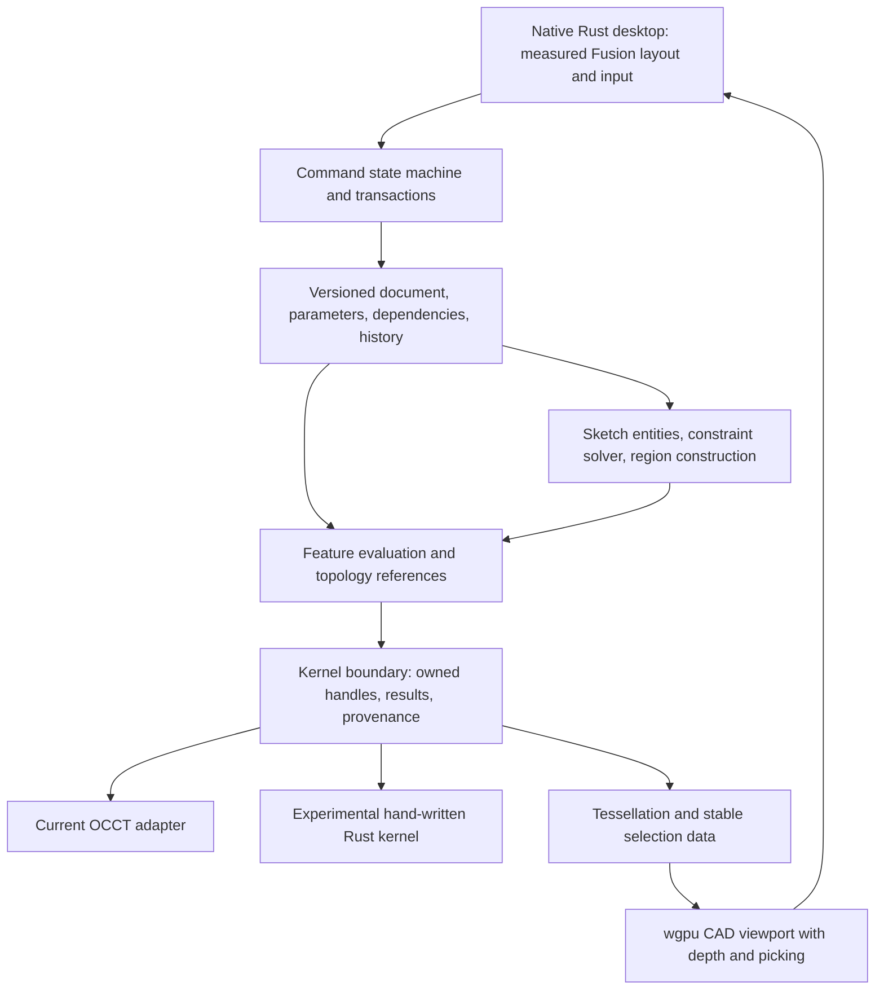

# Fission 180: Fusion architecture, kernel ownership, and the path to 1:1 behavior

Research date: 2026-10-19. Reference: installed Autodesk Fusion **2705.1.30**, **1920 × 1080**, **125% Windows scaling**, preference **Match Device Theme**, visibly dark blue.

## Decision in plain language

**The product requirement is understood: Fission 180 should reproduce Fusion's desktop appearance and observable behavior, not merely offer similar CAD operations.** Sketching and solid modeling are the first implementation slice, not a reduction of the wider target. The reference build must stay fixed while we measure it.

We can develop our own hand-written Rust modeling kernel. That is a substantial independent engineering project; it does not automatically make the product feel like Fusion. My recommendation is to own the application engine now—documents, commands, expressions, constraints, dependencies, history, selection, and rendering—and put the solid kernel behind an explicit interface. Develop a native Rust kernel against the same acceptance corpus, replacing the current backend only as it demonstrates the required behavior. This is a proposed migration, not an implementation completed by this research.

OpenCascade was a practical foundation for real solids. It was not evidence that we had recreated Fusion's engine, and seven passing tests did not establish product parity. Several audited gaps are restrictions in our own code, including a single-solid result requirement that the installed binding already provides a way around.

**Autodesk did not create ShapeManager from an empty codebase.** Its November 27, 2001 announcement says the kernel would build on licensed ACIS 7.0 and a substantial team with solid-modeling experience. That history supports deliberate kernel ownership; it does not support expecting a small new implementation to reproduce a mature kernel immediately. [Autodesk's ShapeManager announcement](https://investors.autodesk.com/news-releases/news-release-details/autodesk-develop-next-generation-solid-modeling-kernel-improve)

No application source, kernel dependency, document format, or Fusion setting was changed in this research pass. The [independent audit](audit-2026-10-19.md) remains open. Reliable matched-camera geometry comparisons remain blocked by Fusion's black/stale viewport capture.

## Evidence rules and what was checked

This report distinguishes four kinds of statements:

- **Published:** Autodesk or another primary technical source describes a public contract or historical fact. Current online documentation is not automatically proof of behavior in build 2705.1.30.
- **Observed:** retained runtime evidence or exact source/artifact inspection establishes a bounded fact.
- **Proposed:** an engineering design for Fission 180, not a recovered Autodesk implementation.
- **Unknown:** the available evidence does not establish the answer.

The installed `reverse-engineer-anything` skill was used to reuse and validate retained native evidence through REA 6.7.0. The selected executable and three previously investigated DLLs were hashed again. `Fusion360.exe` still reports **2705.1.30**, SHA-256 `ddc460d83f3fc496ff7436ceb88e65b99f3a386f29e035064430697337988a5a`; all three DLL hashes match [the native investigation](rea-native.md). No old deployment was substituted.

REA bundle inspection found seven retained sketch-UI records and two sketch-model records, with zero unknown revisions. This validates the retained record inventory; it is not fresh runtime execution or recovery of previously unresolved calls. New identity and summary records are outside the source tree at [engine-research-2026-10-19](C:/Users/Vnm4/Downloads/openfusion-reference/engine-research-2026-10-19).

Fission's Rust source and the exact installed `cadrum 0.9.0` source were inspected with ordinary source tools. Public research used primary sources linked next to their claims. No third-party forum speculation about solver vendors is used as an architectural fact.

## Why we currently use OpenCascade

**Observed implementation:** [the core manifest](../crates/openfusion-core/Cargo.toml) pins cadrum 0.9.0. The binding supplies native OpenCascade solids. [Model construction](../crates/openfusion-core/src/lib.rs#L259) creates an extrusion from profile edges and performs native Boolean operations; mass properties, tessellation, and STEP/STL export also use this backend. The document/history layer is already Rust-owned. Native linking and dependency provenance are recorded in [third-party notices](../THIRD_PARTY_NOTICES.md).

**Engineering rationale, not a recovered decision log:** the project required genuine solids, analytic measurements, Boolean operations, and neutral CAD exchange. Using an existing B-rep kernel made those possible before implementing a complete geometric modeler. It also kept display meshes separate from authoritative geometry. The source demonstrates that benefit; it does not record a formal comparison of every possible kernel.

OCCT publicly documents Boolean operations over groups of shapes, including compounds and split results. Its algorithm documentation also describes tolerance-based interference handling. These are useful building blocks, not a Fusion compatibility guarantee. [OCCT 8.0.1 Boolean Operations](https://www.occt3d.com/dev/doc/overview/html/specification__boolean_operations.html)

The mistake would be treating access to a mature kernel as completion of the CAD application. We still have to implement feature semantics, stable references, region discovery, command transactions, and interactive behavior ourselves.

## How Autodesk built Fusion's engine and software

### 1. An inherited solid kernel, then continued internal development

**Published history:** Autodesk announced ShapeManager in 2001 based on ACIS 7.0, with development focused on its own modeling needs. Autodesk's later support article explicitly identifies Fusion's geometry kernel as ASM. This establishes the kernel family; it does not reveal the exact ASM revision or numerical policies inside our selected Fusion build. [ShapeManager history](https://investors.autodesk.com/news-releases/news-release-details/autodesk-develop-next-generation-solid-modeling-kernel-improve), [Fusion ASM identification](https://www.autodesk.com/support/technical/article/caas/sfdcarticles/sfdcarticles/Unable-to-upload-or-open-SAT-file-in-Fusion-360.html)

Fusion itself commercially launched in 2013. Autodesk's retrospective describes its early direct modeling, T-Splines, and connected data approach. The kernel heritage predates that launch substantially. [Autodesk's Fusion retrospective](https://www.autodesk.com/products/fusion-360/blog/were-celebrating-6-years-of-fusion-360/)

**Implication:** Autodesk combined inherited geometric technology with product-specific engineering and continued development. A custom kernel is an ownership strategy; it is not the reason the ribbon, sketch tools, or undo sequence behave as they do.

### 2. B-rep geometry and topology rather than display triangles

**Published contract:** Fusion describes solid models as closed boundary representations, with geometry distinct from topology. Its API exposes bodies, faces, loops, coedges, edges, and vertices, along with curve and surface evaluation. Editing happens through features in parametric designs or direct modification in direct designs. [Fusion Models: B-Rep and Geometry](https://help.autodesk.com/cloudhelp/ENU/Fusion-360-API/files/BRepGeometry_UM.htm)

**Proposed consequence for our kernel:** retain analytic curves/surfaces and their trimmed boundaries as authoritative data. A triangulated viewport, voxel approximation, or polygon-only Boolean library cannot stand in for the requested solid-modeling behavior. Such representations can be useful caches or separate modeling modes.

Matching a volume is necessary but insufficient: two models can have the same volume and still differ in face selection, edges, curvature, feature references, or subsequent edit behavior. Byte-identical B-rep topology between independent kernels is also not a sensible universal test; test geometric equivalence and the semantic references the user actually edits.

### 3. Sketch entities, dimensions, constraints, and computed regions

**Published contract:** Fusion's sketch object exposes geometry, points, dimensions, constraints, computed profiles, constraint status, and a timeline association. Its documentation explicitly connects editing an existing sketch to timeline rollback. Profiles have one outer loop and can have inner loops defining voids. [Sketch API](https://help.autodesk.com/cloudhelp/ENU/Fusion-360-API/files/fusion_Sketch.htm), [ProfileLoop API](https://help.autodesk.com/cloudhelp/ENU/Fusion-360-API/files/fusion_ProfileLoop.htm)

**Observed native boundary:** `NaSketch10.dll:0x1801faba0`, Evidence `ev_7eec01419e9db485de5a37d5a6b20f45010989f2a80f73180c6e8d1f06555be7`, delegates a sketch solve request to `doSketchConstraintSolving`. Dimension deletion at `0x1801ce5c0`, Evidence `ev_263edb26316bfc2e602293792dd2b1cc8821c931358a6a38684b99882162b6f3`, includes sketch ownership and referenced-geometry bookkeeping. See [native provenance and limits](rea-native.md).

**Unknown:** the actual solver mathematics, decomposition, branch-selection policy, vendor, tolerances, and complete rollback mechanism. We have not established that Fusion uses D-Cubed, and should not repeat that claim without evidence.

Autodesk's 2025 AutoConstrain research describes a learned system that proposes constraints and dimensions referencing sketch primitives. That is evidence about automatic constraint generation, not disclosure of the numerical solver used to satisfy those constraints. [Autodesk Research: AutoConstrain](https://www.research.autodesk.com/blog/using-ai-to-power-autoconstrain-in-fusion-automated-sketching/)

### 4. A command and transaction system above geometry

**Published contract:** the Fusion command API gathers input, validates it, generates previews, and groups execution into an undoable transaction. Its command guide describes aborting the previous preview transaction before generating another and allowing an already-valid preview to become the committed result. Camera navigation can temporarily deactivate a command and later reactivate it. These are documented extension contracts, not proof of every internal built-in command path. [Command object](https://help.autodesk.com/cloudhelp/ENU/Fusion-360-API/files/core_Command.htm), [Fusion Commands](https://help.autodesk.com/cloudhelp/ENU/Fusion-360-API/files/Commands_UM.htm)

**Observed static boundary:** the retained extrusion disassembly includes `Request::isPreview`, `ToolCreationRequestUtil::consumeToolBody`, body-modification calls, and an ASM scoped lock. There is still no successful full native modeling-body Ghidra dossier; previous imports timed out. The lock does not establish all of Fusion's threading or transaction behavior. [Native extrusion evidence](rea-native.md)

**Implication:** preview, invalid draft, commit, cancellation, selection, and undo need explicit application states. A successful call to an extrusion kernel is only one step inside that process.

### 5. Expressions and units form another subsystem

**Published contract:** Fusion accepts expressions and named parameters, evaluates them with units, and formats results using user settings. Its Design API/database length unit is centimeters; angles use radians. Those internal choices do not require us to change Fission's millimeter document unit. [Understanding Units in Fusion](https://help.autodesk.com/cloudhelp/ENU/Fusion-360-API/files/Units_UM.htm), [UnitsManager](https://help.autodesk.com/cloudhelp/ENU/Fusion-360-API/files/core_UnitsManager.htm)

**Observed reference:** the earlier retained runtime scenario accepted `2 * 3 mm` and measured a 40 × 20 × 6 mm body at 4800 mm³. The later audit reproduced our rejection of that expression. A persisted numeric `6` and a matching volume test do not reproduce the expression editor. [Runtime evidence](runtime-extrude-input.md), [audit](audit-2026-10-19.md)

**Proposed implementation:** persist expression text and parameter dependencies as well as evaluated values. Keep incomplete text such as `5 +`, the current validation state, and the last valid preview separate. Convert Fusion API measurements explicitly: 1 cm = 10 mm, 1 cm² = 100 mm², 1 cm³ = 1000 mm³.

### 6. Native UI technology and a family of modeling systems

**Published historical evidence:** a 2022 research paper says its authors modified Fusion's source in C++ and Qt. This supports that implementation context; it does not prove every current component uses the same toolkit. Our retained selected-build artifacts separately contain toolbar XML, QML declarations, native modules, and JavaScript helpers. Static declarations do not identify which control implementation is active in each live state. [Research paper, section 7](https://www.research.autodesk.com/app/uploads/2023/03/TrialAndError-CHI22-Paper.pdf_recFJPtlMJvl7s92I.pdf), [selected-build artifact inventory](rea-native.md)

**Implication for Rust/egui:** toolkit choice affects text metrics, antialiasing, focus, input, popup behavior, and accessibility. A hand-written solid kernel fixes none of these. Measure each mismatch and implement the required behavior in the native Rust application; do not assume default egui widgets will match Qt. Nor would switching to Qt automatically establish fidelity.

Fusion also distinguishes B-rep, T-Spline, and mesh modeling. Autodesk's 2017 modeling handout explains these representations and their conversions; it is historical conceptual evidence, not a current toolbar specification. Autodesk acquired T-Splines technology assets in 2011 and HSMWorks technology in 2012. Fusion's broader scope therefore cannot be reduced to one solid kernel. [Modeling Under the Hood](https://static.au-uw2-prd.autodesk.com/Class_Handout_CP124896_Fusion_360_Modeling_Under_the_Hood_Jake_Fowler.pdf), [Autodesk acquisition filing](https://www.sec.gov/Archives/edgar/data/769397/000076939713000007/adsk-0131201310xk.htm), [HSMWorks history](https://adsknews.autodesk.com/en/news/computer-aided-manufacturing-just-got-a-lot-more-interesting/)

Current public documentation also distinguishes part, assembly, and hybrid design intent, which changes command availability and document organization. Record the selected design intent in every comparison instead of copying an old Fusion layout indiscriminately. [Programming for Design Intent](https://help.autodesk.com/cloudhelp/ENU/Fusion-360-API/files/DesignIntent_UM.htm)

## Which current defects are actually kernel problems?

The following is a source-based diagnosis, not a new runtime fix or full geometry re-test.

| Gap | Evidence and responsible layer | Would a new kernel alone fix it? |
| --- | --- | --- |
| Failed Open followed by Save overwrites rejected file | Desktop adopts the selected path before worker acceptance; audit reproduced changed file bytes. | No. Fix document/session transactions and save ordering. |
| Undo deletes rectangle after dimension edit; Redo does not restore it | Draft-sketch undo removes a profile rather than reversing a dimension command. | No. Implement sketch command history. |
| Unit expression rejected | Numeric parsers and numeric-only feature fields. | No. Add expression evaluation and dependency persistence. |
| Split cut reports two solids as an error | Core Boolean calls use `.build()`, which rejects result counts other than one. Binding already exposes `.build_vec()`. | No demonstrated OCCT limitation. Change result/body handling and replay semantics. |
| Nested profile ignores inner loop | Core reads one stored primitive's edges; document has no region-with-holes representation. | No. Discover selectable regions and pass their loops to modeling. |
| Removing an earlier profile redirects an extrusion | Feature dependency is a positional `usize` profile index. | No. Introduce stable IDs and explicit missing/ambiguous-reference errors. |
| Constraint tools missing | Profile primitives are not a full entity/constraint graph. | No. Requires a sketch model and solver. |
| Exact glyphs, typography, selection, docking, camera feel | Independently drawn UI and incomplete input/rendering implementation. | No. Requires measured UI/interaction work. |
| Tangencies, near-coincident surfaces, difficult blends or offsets | Could expose genuine kernel differences, but this audit did not establish matched Fusion results for them. | Possibly. First isolate a minimal reproducible backend failure. |

Source anchors: [Profile schema](../crates/openfusion-core/src/lib.rs#L56), [Sketch](../crates/openfusion-core/src/lib.rs#L114), [Extrusion dependency](../crates/openfusion-core/src/lib.rs#L141), [build and Booleans](../crates/openfusion-core/src/lib.rs#L259), [Open/Save](../crates/openfusion-desktop/src/app.rs#L408), [sketch undo](../crates/openfusion-desktop/src/app.rs#L465), [worker](../crates/openfusion-desktop/src/worker.rs#L1). Detailed reproductions remain in the [audit](audit-2026-10-19.md).

The exact installed binding's `src/common/boolean.rs:34–47` implements `build()` by calling `build_vec()` and rejecting any count other than one. `src/traits.rs:565–575` documents outer/hole extrusion loops; the native implementation is in `src/ffi.cpp:1472–1509`. Installed source root: `C:/Users/Vnm4/.cargo/registry/src/index.crates.io-1949cf8c6b5b557f/cadrum-0.9.0`. This is evidence of an available API path, not proof that all nested/degenerate regions already work. Multiple output pieces also require body naming, identity, dependency, undo, persistence, and selection policies.

## Proposed application architecture

This is an independent design, **not a recovered Fusion source architecture**. Names are proposed modules/crates; none was created here.

The Rust application owns design intent. Backends return geometry and operation provenance rather than redefining user behavior. There must be no `cadrum::Solid` exposed in the future UI-facing document/feature contracts; currently `Body.solid` and even the public kernel error variant reveal backend coupling.

The boundary needs more than an `extrude()` function:

| Contract | Required behavior |
| --- | --- |
| Inputs | Typed millimeter/angle quantities, analytic curves, region outer/inner loops, explicit selected targets, feature options, tolerance policy. |
| Results | Zero/one/many bodies as explicit outcomes; independent feature policy decides which are valid for a command. Preserve sheets separately when supported. |
| Identity | Opaque owned handles with backend/session identity; creation/modification/deletion provenance for faces and edges. Fission IDs are distinct from backend indices. |
| Queries | Bounds, mass properties, validity, curve/surface evaluators, closest points, ray/selection queries. |
| Display | Tessellation carries face/edge identity, normals, and tolerance metadata; changing mesh quality must not change the solid. |
| Lifecycle | All operations awaited/acknowledged; stale previews can be dropped, committed edits cannot silently disappear. Cancellation and errors preserve the accepted document. |
| Persistence | Versioned feature data and stable references; explicit migration and preserved original files. No opaque backend pointer serialization. |
| Capabilities | A backend reports unsupported operations before execution. Backend selection and fallback are explicit and reproducible. |

Stable application IDs are necessary but insufficient for changing topology. Autodesk's entity-token API itself warns that token strings may change and must be resolved rather than compared as identity. For our independent implementation, record source-feature provenance and detect split, merge, deleted, or ambiguous references instead of silently rebinding by array position or centroid. [BRepFace entityToken](https://help.autodesk.com/cloudhelp/ENU/Fusion-360-API/files/fusion_BRepFace_entityToken.htm)

Do not silently alternate kernels inside a feature chain. Different tolerances and topology can change later references. During development, evaluate the same saved input independently on both backends and report differences. A future mixed chain needs an explicit, validated conversion boundary.

## What a hand-written Rust kernel must contain

The following is an engineering work breakdown, not a claim about Autodesk's private algorithms or a completion schedule.

1. **Numerical foundation:** units, transforms, bounding boxes, conditioning, geometric predicates, root isolation, and explicit error budgets. Separate topological decisions from approximate coordinates. Shewchuk's research demonstrates why ordinary floating-point orientation tests can fail near degeneracy; adaptive predicates help with those tests, but do not solve arbitrary surface intersections. [Robust geometric predicates](https://www.cs.cmu.edu/~quake/robust.html)
2. **Geometric representation:** lines, circles, conics, planes, cylinders, cones, spheres, tori, rational B-spline curves/surfaces, derivatives and parameter ranges. Distinguish an underlying surface from its trimmed face.
3. **Topology:** vertices, oriented edges, coedges, loops, faces, shells, solids, shared adjacency, and per-entity tolerances. Check closed-shell/manifold invariants, orientation, and agreement between 3D curves and 2D face boundaries. A simplistic mesh half-edge structure is not the complete curved B-rep representation.
4. **Intersections and classification:** curve/curve, curve/surface, surface/surface; coincident and tangent cases; periodic seams and singularities; point-in-face/solid classification. Build robust trimming and sewing around these results.
5. **Operations:** extrusion/revolution first, then Boolean splitting/classification/assembly, sweep/loft, blends/chamfers, offsets/shells, draft and direct edits. Treat edge cases and topology provenance as part of the operation.
6. **Display and interchange:** watertight tessellation with bounded error, analytic mass properties and reliable integration, STEP read/write with units, validation and healing, diagnostic errors, cancellation and bounded resource use.

The separate **sketch solver** needs entity parameters, residual equations, Jacobians, solving/decomposition, rank/DOF analysis, contradiction/redundancy diagnosis, dragging continuity and solution-branch selection. A mathematically valid but mirrored or jumping solution can still fail Fusion interaction acceptance. This solver can be developed in Rust without first replacing the 3D solid kernel.

There is no evidence-based calendar estimate yet. A general-purpose kernel plus a full Fusion-equivalent product is a major sustained effort. Prototype throughput cannot establish how long robust blending, healing, topology tracking, or the other workspaces will take.

## Options and migration recommendation

| Path | What it achieves | Main consequence |
| --- | --- | --- |
| Own application engine; retain OCCT adapter | Lets us pursue measured Fusion workflows and repair application defects immediately. | Backend differences still need tests; kernel ownership remains partial. |
| Own application engine plus staged Rust kernel | Gives a route to full algorithm ownership with the current implementation available for comparison. | Two backends and migration infrastructure require maintenance. **Recommended path.** |
| Replace OCCT immediately with a new kernel | Removes the runtime dependency once all required operations exist. | Existing solids/exchange can regress while large new numerical and topology problems are introduced. No evidence this is the shortest route to 1:1 feel. |
| Fork/customize OCCT | Allows changes to a mature kernel. | Remains derived from an existing kernel, with its licensing and maintenance obligations; does not satisfy a literal from-scratch engine goal. |

A kernel replacement must not be declared complete while production features still call OCCT through hidden fallback. Conversely, retaining OCCT during staged development does not waive the exact-behavior target. The [current development instructions](../AGENTS.md) require real OpenCascade solids today; a future backend cutover needs those instructions and dependency notices updated together with demonstrated support.

## What “exactly like Fusion” means for acceptance

Keep the ambition literal, but make claims finite and testable. We cannot prove equality for every possible future input, every unobserved workflow, or every Autodesk cloud service from a screenshot. Record acceptance per scenario, with **match / mismatch / blocked / untested** and a separate observed-versus-inferred label. Do not produce a whole-product parity percentage.

Each scenario must specify:

- Exact reference executable, design intent, entitlements, theme, physical/logical bounds, DPI, language, preferences, starting document, and camera.
- Every mouse/key event, preselection, active tool, focus owner, input draft, validation message, preview, commit/cancel, undo/redo, save, and reopen.
- Geometry: body count, bounds, area/volume, analytic surfaces where relevant, feature parameters, topology references, and resulting edit behavior.
- Visuals: layout, text baselines and clipping, glyph silhouettes, selected/hover/disabled states, colors, line weights, grid, projection, and overlays. Compare separate regions; explain antialiasing differences rather than hiding them in one average score.
- Interaction timing: cold/warm startup, preview latency, input-to-frame latency, rebuild, save and p50/p95 frame times on the same hardware and workload. Define acceptable bounds before measurement.

For simple analytic fixtures, begin with the audit's proposed 1e-5 mm linear and 1e-5 mm³ volume checks, subject to measured reference precision. These are test-specific proposals, not Fusion's internal tolerances. Pixel equality and numerical equality are separate requirements.

The visual target remains matching measured positions, dimensions, text, glyphs, colors, and interaction states. Any accepted rasterization allowance must be explicit and bounded; a perceptible mismatch stays a mismatch. Fission 180's requested product name is an intentional identity difference, not evidence of a visual match to Autodesk branding.

## Ordered next work and completion gates

### A. Make persistence and command history trustworthy first

Fix failed-Open path adoption, pending-edit Save ordering, document-history isolation, stale worker acknowledgements, and exhausted ID handling. Preserve the last accepted geometry/display on evaluation or meshing failure. Add regression scenarios from the audit, including immediate Save during a delayed edit and invalid-file hashes before/after rejected Open. A transactional Save should use a staged write and platform-appropriate atomic replacement, preserve the original on failure, and update file identity/dirty state only on success.

**Gate:** rejected Open cannot redirect Save; every accepted edit is present after save/reopen; no cross-document undo; failed operations preserve document, path, history, and display. This is required regardless of backend.

### B. Recover and freeze the comparison baseline

Resolve the Fusion black/stale capture issue in a scratch session without disturbing existing unsaved work. Verify a known origin/grid and rotated solid, then retain camera/projection and DPI information. Keep build 2705.1.30 as the baseline; document later upgrades separately.

**Gate:** matched-camera setup is reproducible. Until then, geometry appearance comparisons remain blocked; usable toolbar/palette observations can still support narrowly scoped findings.

### C. Replace primitive-only sketch state with an editable sketch model

Introduce stable line/arc/circle/point identities, construction geometry, dimensions, constraints, expressions and parameter dependencies. Implement command-based sketch undo/redo. Build the region arrangement from split intersections and loop containment, with explicit region references for extrusion. A rectangle tool should create its constituent geometry and relationships, with exact inferred-constraint behavior established by reference scenarios.

During v1 migration, resolve each `Extrusion.profile` against the original stored primitive array before recomputing or reordering regions. Map that original selection to a stable migrated reference; if the new arrangement makes the intended selection ambiguous, preserve the original file and fail explicitly. Assigning new IDs alone cannot recover lost selection intent.

**Gate:** width 40 → 80 → undo 40 → redo 80 preserves the same intended rectangle; `2 * 3 mm` commits and re-edits as an expression; a circle inside a rectangle offers the correct selectable regions; contradictory constraints preserve the last accepted state and produce a reproducible diagnostic.

### D. Widen feature and kernel contracts before swapping backends

Introduce the kernel boundary; handle all Boolean result pieces; implement explicit target selection, stable body identities, holes and multiple regions. Define empty-result semantics per command after reference observation. Replace positional feature dependencies and support actual timeline editing with rollback/recompute. Keep v1 `.ofrust` files readable through an explicit migration, preserving their original bytes until a deliberate successful save.

**Gate:** the split-cut fixture yields two 2700 mm³ solids, total 5400 mm³; the annular-region fixture yields `6000 - 125π = 5607.300918301276 mm³`; profile insert/delete cannot redirect a feature silently. These are analytic acceptance fixtures; Fusion-specific body naming/selection behavior still requires observation. Preview/cancel/undo and saved replay must agree.

### E. Implement the first Rust kernel slice behind the boundary

Build analytic primitives, validated topology, planar/circular regions with holes, linear extrusion and mass properties. Then implement supported Boolean combinations, including split, empty, touching, near-degenerate, and transformed cases. Keep unsupported operations explicit. Run analytic checks, randomized/metamorphic tests, and differential tests against both OCCT and measured Fusion outputs. Examples: rigid transforms preserve volume; A minus itself has the declared empty outcome; subtraction volume cannot exceed the input volume for valid finite solids; tessellation refinement does not alter geometry.

**Gate:** the slice runs without OCCT calls, reports validity/tolerance/provenance, passes the published corpus, survives cancel/failure/undo/reopen, and exchanges supported solids with an independent CAD system. Equal volume alone cannot pass it. This gate establishes a limited slice, not a complete replacement.

### F. Match the native desktop continuously

In parallel with geometry development, implement stable face/edge picking, depth-correct viewport rendering, complete camera gestures, snapping/inference, contextual palettes, input focus and keyboard routing, menus, docking, typography, and independently authored matching glyphs. Compare the actual running Rust app after each change. Work by complete states and workflows, not by filling the screen with painted controls.

**Gate:** the common part can be created, dimension-edited, cut, undone/redone, saved, reopened, and feature-edited through the same observed inputs and states in both applications. Every discrepancy stays listed until demonstrated resolved.

### G. Expand kernel coverage and the rest of the product

Extend the Rust backend to general trimmed surfaces, curved Boolean intersections, fillets/chamfers, shell/offset, sweeps/lofts, healing, reliable STEP exchange, and topology provenance. Cut over only when the required feature corpus passes; retain a recoverable migration path for saved documents. Remove OCCT runtime linkage only after an explicit dependency and call-path check.

Separately inventory assemblies/configurations, surface/mesh/form/sheet-metal/plastic, drawings, rendering, animation, simulation, manufacturing, electronics, and project/collaboration/cloud behavior. Each needs real document/service semantics and representative acceptance cases. A native solid kernel does not implement these workspaces.

## Remaining research questions

| Question | Status and next evidence |
| --- | --- |
| Why is the current app built on OCCT? | Source explains its concrete role; original comparative selection history is undocumented. |
| What is Fusion's solid kernel lineage? | Answered at family/history level from Autodesk sources. Exact shipped ASM revision remains unknown. |
| Was Fusion built entirely from scratch? | No: primary sources establish licensed kernel heritage and acquired technologies. Exact internal integration history is only partially public. |
| How does Fusion solve sketches numerically? | Unresolved beyond the retained request boundary. Investigate callees with a focused REA profile and observe constrained-drag/contradiction cases. |
| What does the full extrusion implementation do? | Partial static boundary only. Do not repeat unchanged timed-out whole-module analysis; use a bounded function/profile strategy with recorded coverage limits. |
| Will a new Rust kernel make the UI 1:1? | No causal evidence for that claim. UI and interaction matching require independent work and acceptance. |
| Can we own a Rust kernel? | Technically feasible as an engineering program. This report provides stages; no prototype or replacement was implemented. |
| Is exact parity established? | No. Audit defects remain open; matched-camera comparisons remain blocked. |

The next implementation milestone should be **a safe, fully replayable sketch-to-solid workflow with measured Fusion interaction contracts**, while introducing the boundary that allows a genuinely independent Rust kernel. That advances the stated 1:1 objective and kernel ownership without pretending either has already been achieved.
